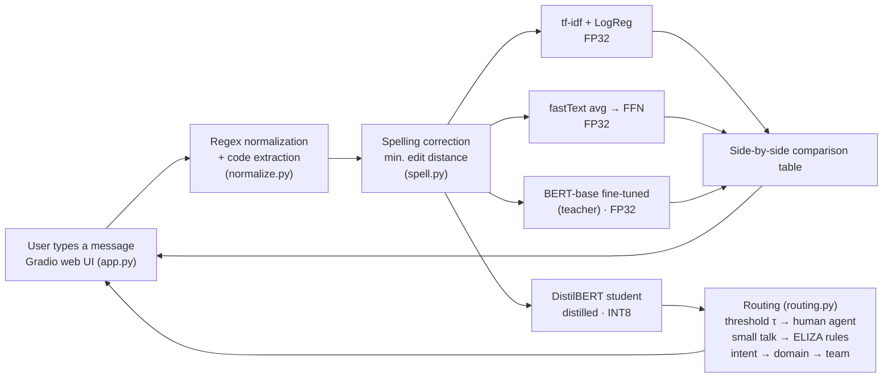

# NovaAssist Support Ticket Router

**SWE015 – Introduction to Large Language Models · Homework · Use Case 2 – Customer Support Ticket Router**

NovaAssist is a fictional virtual-assistant company that receives thousands of English support messages a day.
Every message must be routed to the team that owns its product area, and this has to happen instantly.
The app takes a free-text message and normalizes it, fixes misspelled words and extracts codes.
It then predicts the intent with a confidence score and shows the team the message is routed to.
Low-confidence and out-of-scope messages go to a **human agent**. Greetings and small talk get an **ELIZA-style rule-based reply**.
The predictions of all four models are shown side by side.
The routing decision is made by a **distilled and INT8-quantized DistilBERT**.

What makes this project different:
1. **Typo robustness test set.** Customers type fast and make typos. I build a copy of the official test set with keyboard typos
   (QWERTY-neighbour key, dropped, swapped or doubled letters; `src/typos.py`, fixed seed).
   Every model is reported on both the clean and the typo test set.
   An ablation (tf-idf without spell correction) measures how much the edit-distance correction helps.
2. **Fast edit-distance correction.** It uses a symmetric-delete index (SymSpell idea) over the training vocabulary and a product catalog (`src/spell.py`).
3. **Per-model out-of-scope threshold.** The threshold τ is tuned on the validation set and never on the test set (`src/benchmark.py`).

## Quick start (run the app)

Requires Python 3.11–3.13.

```bash
git clone https://github.com/berkotun/support-ticket-router.git
cd support-ticket-router
python -m venv .venv
.venv\Scripts\activate            # Windows   (macOS / Linux: source .venv/bin/activate)
pip install -r requirements.txt
python app.py                     # → open http://127.0.0.1:7860
```

On the first run, `app.py` downloads the trained models (≈ 0.7 GB) from the public Hugging Face Hub repository
set in `src/config.py → MODELS_REPO` ([berktn/support-ticket-router-models](https://huggingface.co/berktn/support-ticket-router-models)). Everything runs on CPU.

## Architecture



* **Where it runs:** all components run in **one Python process on the CPU** of the machine that runs `python app.py`.
  The weights are downloaded once from the Hugging Face Hub into `models/`.
* **Training** runs in Google Colab on a T4 GPU (`notebooks/train_and_benchmark_colab.ipynb`).
  The **benchmark** runs on CPU.
* The routing decision always comes from the DistilBERT INT8 model. The other three models are shown for comparison.

## Technique map

| Area | Technique | Where in code |
|---|---|---|
| **A** Neural networks | own fastText embeddings (skip-gram + char n-grams) trained on the training messages; averaged message vectors → feedforward network (ReLU, dropout) trained with **SGD + backpropagation** | `src/train_fasttext_ffn.py` |
| **B** Classical NLP | **regex normalization** and **model-code extraction** (model, flight, card, amount, date); **minimum edit distance** spelling correction of misspelled product names; **ELIZA-style** rule-based replies for small talk; **tf-idf + logistic regression** baseline | `src/normalize.py`, `src/spell.py`, `src/eliza.py`, `src/train_tfidf.py` |
| **C** Transformers | **BERT** (`bert-base-uncased`) fine-tuned with a classification head for 151-way intent classification; WordPiece tokenizer; attention | `src/train_teacher.py`, `src/transformer_utils.py` |
| **D** Efficient models | **knowledge distillation** BERT-base → DistilBERT (soft targets, T = 2); **dynamic INT8 quantization**; size / latency / accuracy benchmark | `src/distill.py`, `src/quantize.py`, `src/benchmark.py` |

Model ladder: tf-idf + LogReg (classical baseline) → fastText + FFN (own neural network) → BERT-base (Transformer) → DistilBERT, distilled and INT8-quantized (quantized Transformer).

## Data

* **CLINC150**, "plus" version (Larson et al., 2019), English, CC BY 3.0. It has 150 intents in 10 domains plus an out-of-scope class.
  Hugging Face: [`clinc/clinc_oos`](https://huggingface.co/datasets/clinc/clinc_oos) (config `plus`). Original: [github.com/clinc/oos-eval](https://github.com/clinc/oos-eval).
* Official splits: **train** 15,250 messages (15,000 in-scope + 250 out-of-scope), **validation** 3,100 messages, **test** 5,500 messages (4,500 in-scope + 1,000 out-of-scope).
  The validation set is used for model selection and thresholds. The **test set** is used only for the final evaluation, and all models are evaluated on it.
* `test_typos.csv`: the same 5,500 test messages with keyboard typos (same labels).
* Routing table: each of the 10 CLINC150 domains is owned by one support team (`src/domains.py`).

## Reproduce training and results

Open `notebooks/train_and_benchmark_colab.ipynb` in Google Colab (Runtime → T4 GPU) and run all cells, or run:

```bash
python -m src.prepare_data         # download, splits, typo test set, spelling vocabulary
python -m src.train_tfidf          # tf-idf + logistic regression
python -m src.train_fasttext_ffn   # fastText + feedforward network
python -m src.train_teacher        # BERT-base fine-tuning (GPU recommended)
python -m src.distill              # knowledge distillation into DistilBERT
python -m src.quantize             # dynamic INT8 quantization
python -m src.benchmark            # → results/results_table.md
python -m src.upload_models berktn/support-ticket-router-models
```

## Results

See [`results/results_table.md`](results/results_table.md). It lists the task metrics, size (MB), latency (ms) and the hardware they were measured on.
All numbers come from `src/benchmark.py`.
* **In-scope accuracy:** correct intent on the 4,500 in-scope test messages.
* **Out-of-scope recall:** share of the 1,000 out-of-scope test messages sent to a human agent.
* **Routing accuracy:** correct team or human agent, over all 5,500 test messages.
* **Latency:** batch size 1, mean over 200 messages after 10 warm-up runs, measured end to end (preprocessing + model).

## Repository layout

```
app.py                       Gradio application (DistilBERT INT8 makes the routing decision)
src/config.py                paths and hyper-parameters
src/domains.py               intent → domain → team routing table
src/normalize.py             regex normalization + code extraction (B)
src/spell.py                 edit-distance spelling correction (B)
src/eliza.py                 ELIZA-style small-talk rules (B)
src/preprocess.py            shared preprocessing pipeline
src/typos.py                 typo test set generator
src/prepare_data.py          download + splits
src/train_tfidf.py           tf-idf + logistic regression (B)
src/train_fasttext_ffn.py    fastText + feedforward network (A)
src/transformer_utils.py     fine-tuning / distillation loop (C, D)
src/train_teacher.py         BERT-base fine-tuning (C)
src/distill.py               knowledge distillation into DistilBERT (D)
src/quantize.py              dynamic INT8 quantization (D)
src/models.py                common predictor interface
src/routing.py               threshold, ELIZA and team decision
src/benchmark.py             evaluation on the same test set (R3 / R4)
src/upload_models.py         push weights to the Hugging Face Hub
notebooks/                   Colab notebook that reproduces everything
```

## References

* Larson, S. et al. (2019). *An Evaluation Dataset for Intent Classification and Out-of-Scope Prediction.* EMNLP-IJCNLP 2019.
* Devlin, J. et al. (2019). *BERT: Pre-training of Deep Bidirectional Transformers for Language Understanding.* NAACL 2019.
* Sanh, V. et al. (2019). *DistilBERT, a distilled version of BERT.* arXiv:1910.01108.
* Hinton, G., Vinyals, O., Dean, J. (2015). *Distilling the Knowledge in a Neural Network.* arXiv:1503.02531.
* Bojanowski, P. et al. (2017). *Enriching Word Vectors with Subword Information.* TACL.
* Weizenbaum, J. (1966). *ELIZA.* Communications of the ACM.
* Jurafsky, D., Martin, J. H. *Speech and Language Processing*, 3rd ed. draft (edit distance, tf-idf, logistic regression).
